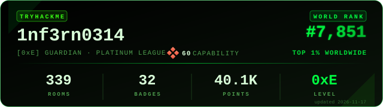

# // Saptarshi Nanda

> Hardware and IoT Security

## About Me

- **Learning:** Rust

## Tech Stack

**Languages:**  
    

**Tools & DevOps:**  
 

## TryHackMe Badge

## GitHub Stats

## Featured Projects

| Project | Description | Link |
|---------|-------------|------|
| **Zeus 2.4** | Portable Wireless Security Audit Tool | [View →](https://github.com/1nf3rn0314/zeus_2.4) |

## Connect With Me

